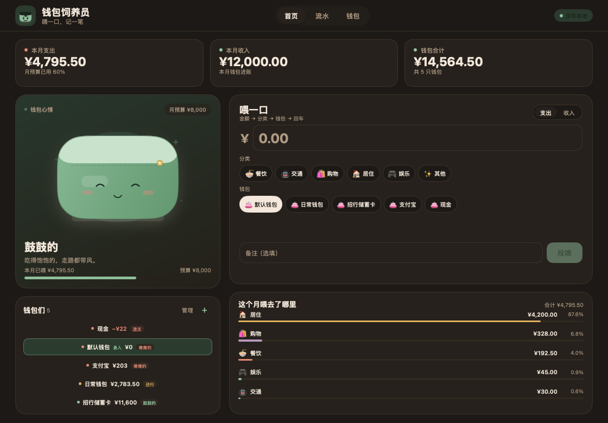

# 钱包饲养员 · WalletFeeder

把记账变成投喂钱包的小工具。每记一笔支出，就是在给钱包喂一口；它会用一张圆滚滚的脸回应你，让"坚持记账"这件事不那么像在填表。


这是一个 **MyGo Native UI** 应用：界面由 Go 直接绘制，不启动 webview。窗口打开后立刻可以输入，账本读写放在后台 goroutine；数据全部保存在本机 SQLite 文件中，不联网、不登录。

## 快速开始

需要 Go 1.27 或更新版本。

```sh
go run .
```

运行测试：

```sh
go test ./...
```

MyGo 原生 SQLite 插件在普通开发环境中会按需下载校验过的原生库；这个仓库的开发机上额外带了一份 macOS arm64 的
`resources/libmygo-sqlite3.dylib`，启动时会自动找到它。其他平台保留同名 lib 或让插件自行下载即可。

打包（需要 MyGo CLI）：

```sh
go run github.com/egoist/mygo/cmd/mygo@v0.8.3 build
```

## 已经做好的事

### 喂一口

- 首页就是录入区，金额输入框自动获得焦点，已默认选中一只钱包。
- 输入金额 → 点分类 → 点钱包 → 回车（或点"投喂"）即保存。
- 支出会让对应钱包余额减少，收入会让余额增加。
- 金额为 0、负数、非数字或超过两位小数时，按钮禁用并提示；缺少分类或钱包时，对应选择器会抖动并显示红色边框。
- 保存成功后清空金额、分类和备注，并把焦点送回金额框，接着喂下一口。
- 钱包角色有 **鼓鼓的 / 还行 / 瘪瘪的** 三档脸和轮廓，余额为负时显示"透支"。保存成功后角色会进入 300ms 的"被喂了一口"状态，随即回落到新余额对应的状态。
- 反馈是非模态的，不遮挡录入区。


### 钱包与账

- 首次打开自动创建余额为 0 的"默认钱包"；之后可自由新增、改名、删除。
- 新增钱包支持 0 或正数初始余额。
- 删除钱包前展示关联流水数量；删除后历史流水保留，但不再计入钱包合计。
- 余额校准会在同一个事务里生成一条 `余额校准` 流水，正差为调整收入、负差为调整支出。
- 删除普通流水会回滚钱包余额；删除校准流水不会回滚余额，并在确认框中明确说明。所有涉及余额的写入都在同一个 SQLite 事务中完成。

### 看一眼

- 首页顶部固定展示 **本月支出 / 本月收入 / 钱包合计**，由 SQLite 聚合当前自然月数据。
- 当月无流水显示 0 和"还没投喂过，从第一笔开始吧"。
- 分类占比按支出聚合，降序排列；超过 5 类时，第 6 类起合并为"其他"。每行显示图标、名称、金额、一位小数占比和等宽色条。无支出时整个分类区块隐藏。
- 首页钱包列表显示名称、余额和胖瘦标签；透支钱包排在最前。点击任意钱包即可把它设为录入口的默认钱包。
- 月预算决定角色的饱腹感，默认 ¥3,000，可从首页或钱包页调整。

### 翻旧账

- 流水按月浏览，可切上一月 / 下一月；未来月份显示空状态而不是报错。
- 流水按日期倒序、同日按录入时间倒序，使用 MyGo 的虚拟化 `ui.List`。
- 每行展示日期、分类、钱包名、金额、备注（如有）和删除入口；收入为正向绿色，支出为负向。
- 顶部固定显示当月的支出、收入、结余和"本月合计"。
- 删除前二次确认，删除后概览、分类和钱包余额一并刷新。


深色外观会跟随系统设置：



## 设计决定

- **金额全部用 int64 分保存**，不经过 float；解析、格式化、聚合都在整型上完成。
- **收入会增加钱包余额**，因此 Story 4.2 中"删除收入时余额减去金额"能对称成立；删除也是同一事务中的反向调整。
- **月预算只影响钱包角色的饱腹感和状态，不限制记账**。三档阈值严格按需求：>50% 鼓鼓的，20%–50% 还行，<20% 或负数瘪瘪的。
- **初始余额是钱包的开户状态**，不会伪造一条当月收入流水，避免污染"本月收入"。
- **删除钱包只解除关联**：流水保留，`wallet_name` 快照保证旧账还能读；钱包合计立刻不再包含它。
- **校准流水单独标记**（`is_adjustment`），列表中有"校准"徽章。删除它只删流水、不自动冲账。
- **所有刷新都是整屏快照**：一次任务读取钱包、当前月、目标月、分类和预算，主线程一次性替换状态，避免界面出现半新半旧的数据。读写通过一把数据锁串行化，快照不会读到一半被写事务插队。
- 数据库文件位于 `mygo.PathUserData/walletfeeder.db`。开发时可用 `WALLETFEEDER_DATA_DIR` 指向临时目录（目录需已存在）。
- 原生库只在启动时加载一次；没有动画时窗口不请求帧，角色喂食反馈使用时间计算 + `c.After`，没有常驻动画循环。
- 无窗口 `ui.Tester` 下测量首页完整帧构建约为 **0.13ms**（Apple M1 Max，`go test -bench BenchmarkHomeFrame`）。

## 结构

| 文件 | 内容 |
|---|---|
| `main.go` | 应用名、窗口、菜单、数据目录和 SQLite 原生库定位 |
| `app.go` | 应用状态、后台任务、保存 / 删除 / 校准 / 预算流程、焦点与反馈 |
| `store.go` | SQLite schema、快照聚合、全部原子事务 |
| `view.go` | 根视图、顶部导航、加载 / 错误页、模态框、删除确认 |
| `home.go` | 首页概览、快速投喂、钱包角色卡片、分类占比 |
| `ledger.go` | 月份切换、月合计、虚拟化流水列表 |
| `wallets.go` | 钱包管理页与预算侧栏 |
| `wallet_art.go` | 钱包角色、品牌标记的纯 `ui.Painter` 绘制 |
| `theme.go` | 暖色明暗主题和心情色板 |
| `money.go` / `mood.go` / `categories.go` | 金额、心情阈值和分类聚合 |
| `*_test.go` | 金额/心情/分类单元测试、SQLite 事务测试、`ui.Tester` 交互测试 |

## 交互小抄

- `⌘1` 首页，`⌘2` 流水，`⌘3` 钱包。
- 首页金额框聚焦时按回车提交。
- 点击分类、钱包后焦点会回到金额框，所以选完再回车就能记下一笔。
- 删除钱包或流水都会给出就地确认框；校准流水的说明文字会明确提示"删除后余额不会自动回滚"。

## 测试

```sh
go test ./...
```

覆盖：

- 金额解析（元/分、正负、精度、上限、格式化）和心情三档边界；
- 默认钱包只创建一次、支出/收入余额联动、删除回滚、校准差额流水、校准删除不回滚、钱包删除后的孤儿流水、月份边界与排序、改名的流水展示；
- `ui.Tester` 无窗口测试：空状态、金额禁用、三步入账 + 回车、缺分类抖动、收入分类切换、删除确认、未来月份、新增钱包、校准弹窗、自动聚焦、透支排序、存储失败不丢输入、备注输入不被金额框抢焦点；
- 额外用触发器强制余额更新失败，验证流水和余额在同一事务里完整回滚。

`WF_SNAPSHOT=1 go test -run TestSnapshots` 会重新生成 `docs/screenshots/` 下的界面截图。

## 范围

MVP 按需求克制：不做多账本、云同步、多用户、导入导出、周期性自动记账。界面不包含 webview，无网络请求。
