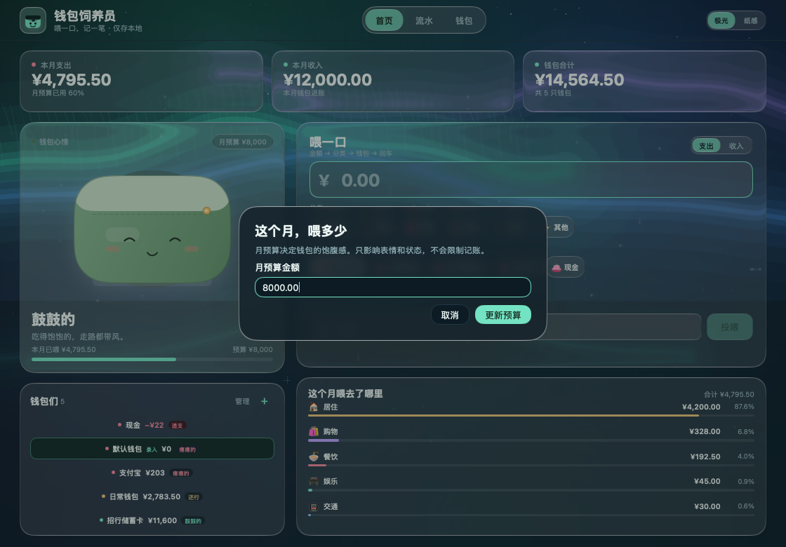
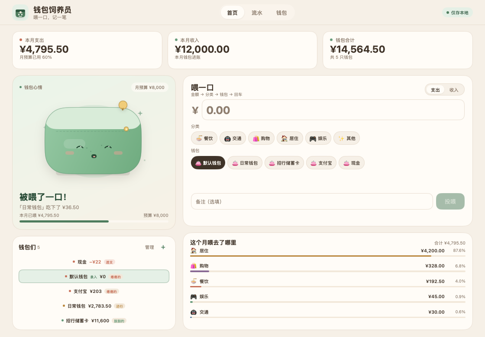
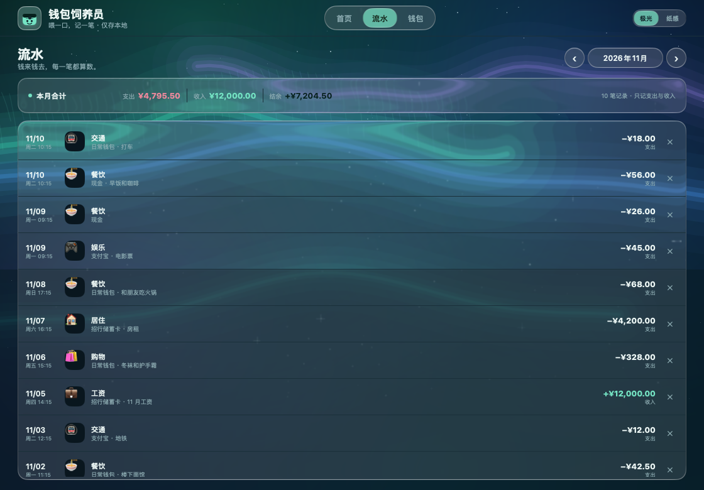
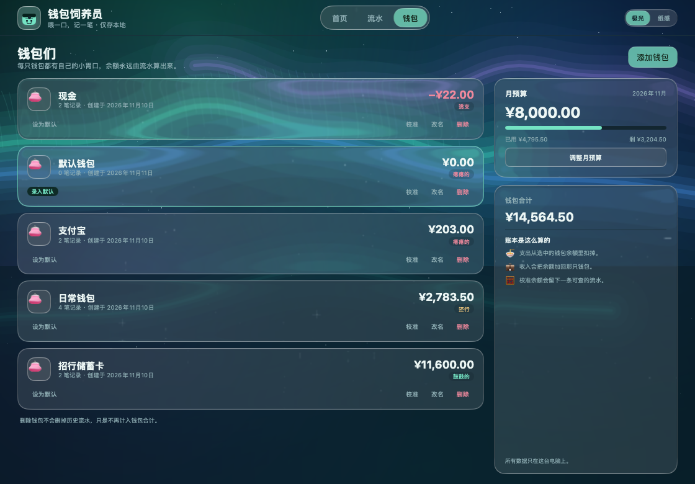

# 钱包饲养员 · WalletFeeder

把记账变成投喂钱包的小工具。每记一笔支出，就是在给钱包喂一口；它会用一张圆滚滚的脸回应你，让"坚持记账"这件事不那么像在填表。

这是 **MyGo Native UI** 应用：界面由 Go 直接绘制，不启动 webview。窗口打开后立刻可以输入，账本读写放在后台 goroutine；数据全部保存在本机 SQLite 文件中，不联网、不登录。

界面默认使用 **极光 Liquid Glass（液态玻璃）**：深色夜空、青绿/蓝紫光带与星点，并在标题栏内提供「极光 / 纸感」切换。


## 打开应用

 macOS 版本已经打包为可直接双击的 `.app`：

```sh
open build/darwin-arm64/WalletFeeder.app
```

也可以从 Finder 进入 `build/darwin-arm64/` 双击 `WalletFeeder.app`，或把它拖进「应用程序」文件夹。当前包是 ad-hoc 签名（本机开发版）；它不会被公证，在本机双击即可启动。

可转移的压缩包位于 `build/WalletFeeder-0.1.0-macos-arm64.zip`。

只运行源码也可以：

```sh
go run .
```

运行测试：

```sh
go test ./...
```

重新打包：

```sh
go run github.com/egoist/mygo/cmd/mygo@v0.8.3 build -skip-dmg .
```

MyGo 原生 SQLite 插件在普通开发环境中会按需下载校验过的原生库；这个仓库带了一份 macOS arm64 的
`resources/libmygo-sqlite3.dylib`，开发运行时会自动找到。打包时 MyGo CLI 会按目标平台放入匹配的库。

## Liquid Glass 在 MyGo 上是怎么实现的

可以。MyGo 0.8.3 在两处支持 macOS 26+ 的 Liquid Glass：

1. **窗口材质**：`WindowOptions{Vibrancy: mygo.VibrancyGlass}` / `VibrancyGlassClear` 使用系统的 `NSGlassEffectView`，让窗口本身带桌面透视、折射和高光边。`SetVibrancyTint` 可在运行时调色。
2. **原生 UI 内的玻璃**：`github.com/egoist/mygo/plugins/glass` 在窗口内部绘制同款材质，支持 `Regular` / `Clear`、`Tint`、`Interactive` 按压回弹、`Clarity`、`glass.Group` 合并相邻面板、滚动边缘和渐变背景模糊。它使用 GPU 着色器，CPU 渲染时自带回退。

这个应用主要使用第二种，因为页面里的卡片、按钮、输入框全部是原生 UI。`NSGlassEffectView` 不能采样同一帧里绘制的原生内容，所以要让每块卡片折射它们身后真实的彩色背景，玻璃插件是正确的工具；窗口标题栏则改成了 `TitleBarHiddenInset`，红绿灯直接浮在我们的玻璃标题栏上。

本项目的极光外观细节：

- 自绘极光夜空：深蓝黑渐变底、青绿/蓝紫的层叠光带、细竖纹和星点，让玻璃有可折射、可模糊的内容；
- 所有主卡片使用 MyGo 玻璃材质，外圈保留细高光边；
- 导航、收支切换、分类/钱包 chips、主按钮使用 `Interactive` 玻璃；选中态用低透明度 accent tint，按下时会长大一点；
- 极光外观固定使用深色玻璃主题，保证光带上的白字有足够对比；纸感外观跟随系统明暗；
- 输入框改成透明底，外层玻璃 field 负责聚焦高光和焦点色。

点右上角的「纸感」可以切回原来的暖色纸张界面：


玻璃对话框、表单和操作按钮也使用同一套材质：



## 已经做好的功能

### 喂一口

- 首页就是录入区，金额输入框自动获得焦点，并默认选中一只钱包。
- 输入金额 → 点分类 → 点钱包 → 回车（或点"投喂"）即保存。
- 支出减少对应钱包余额，收入增加余额；金额为 0、负数、非数字或超过两位小数时，按钮禁用并提示；缺少分类或钱包时，对应选择器抖动高亮。
- 保存成功后清空金额、分类和备注并重新聚焦金额框；钱包角色会进入 300ms 的"被喂了一口"状态，非模态，不遮挡录入口。
- 写入提交和界面刷新分别报告结果；若写入已提交但刷新失败，表单按成功处理，页面提供“刷新账本”按钮，只重读数据而不会重复写入。保存期间对话框不可被 Escape 或遮罩误关闭。
- 角色有 **鼓鼓的 / 还行 / 瘪瘪的** 三档，余额为负显示"透支"；颜色和轮廓随状态变化。



### 钱包与账

- 首次打开自动创建余额为 0 的“默认钱包”；支持新增、改名、删除钱包，新增时初始余额可为 0 或正数。
- 删除钱包前展示关联流水数量；删除后历史流水保留，但不再计入钱包合计。
- 余额校准会在同一事务中生成带“校准”标记的流水；删除普通流水会回滚余额，删除校准流水则明确提示不会回滚。
- 所有涉及余额的写入均在同一个 SQLite 事务中完成；失败不会留下半笔流水或半截余额。

### 看一眼

- 首页顶部固定展示 **本月支出 / 本月收入 / 钱包合计**，数据由 SQLite 聚合当前自然月。
- 无记录时显示 0 与“还没投喂过，从第一笔开始吧”。
- 分类占比按支出聚合，前 5 类 + “其他”；每行有色条、金额和一位小数占比。无支出时整个分类区块隐藏。
- 钱包状态显示余额与胖瘦标签，透支钱包排在最前；点击钱包即可切换录入口默认钱包。
- 月预算决定角色的饱腹感，默认 ¥3,000，可从首页或钱包页调整。

### 翻旧账

- 流水按月浏览，可切上一月 / 下一月，未来月份显示空状态而不报错。
- 流水按日期倒序、同日按录入时间倒序，使用 MyGo 的虚拟化 `ui.List`。
- 每条展示日期、分类、钱包、金额、备注（如有）和删除入口；收入绿色正向，支出负向。
- 二次确认删除，删除后概览、分类和钱包余额一并刷新。





## 设计与实现

- **金额全部用 int64 分保存**，不经过 float；解析、格式化、聚合都在整型上完成。
- **收入增加钱包余额**，因此 Story 4.2 的“删除收入时余额减去金额”是对称成立的。
- **初始余额是钱包的开户状态**，不会伪造一条当月收入流水，避免污染“本月收入”。
- **删除钱包只解除关联**：流水中的钱包名快照保留；钱包合计立刻不再包含该钱包。
- **校准流水单独标记**（`is_adjustment`），列表有“校准”徽章；删除它只删流水，不自动冲账。
- **所有刷新都是整屏快照**，主线程一次性替换状态；后台任务通过 MyGo 的线程安全 `Window.Update` 回主线程。
- **快照一致性**由单实例锁、应用层数据锁和单连接 SQLite 保证，避免多个进程并发写库，或在多次读取之间插入一次写事务。
- **关闭安全**由可取消的任务上下文和等待组保证：退出时等待启动、读取和写入任务结束，再关闭数据库；迟到的 UI 回调不会访问已关闭的连接。
- **无窗口测试**使用 `ui.Tester`；`WF_SNAPSHOT=1 go test -run TestSnapshots` 会重写 `docs/screenshots/`。
- 数据库位于 `mygo.PathUserData/walletfeeder.db`。开发时可用 `WALLETFEEDER_DATA_DIR` 指向专用数据目录；启动时会将目录收紧为 `0700`、账本文件收紧为 `0600`。
- 无动画时窗口不请求帧；仅在跨月时安排一次自动刷新，玻璃材质只在有内容重绘时更新，没有常驻动画循环。

## 结构

| 文件 | 内容 |
|---|---|
| `main.go` | 应用名、窗口（隐藏标题栏）、菜单、数据目录和 SQLite 原生库定位 |
| `app.go` | 应用状态、后台任务、保存 / 删除 / 校准 / 预算流程、焦点与反馈 |
| `store.go` | SQLite schema、快照聚合、全部原子事务 |
| `view.go` | 根视图、玻璃标题栏与外观切换、加载 / 错误页、对话框、删除确认 |
| `glass_ui.go` | Liquid Glass 面板/按钮辅助函数、玻璃背景绘制 |
| `home.go` | 首页概览、快速投喂、钱包角色卡片、分类占比 |
| `ledger.go` | 月份切换、月合计、虚拟化流水列表 |
| `wallets.go` | 钱包管理页与预算侧栏 |
| `wallet_art.go` | 钱包角色、品牌标记的纯 `ui.Painter` 绘制 |
| `theme.go` | 暖色明暗主题和心情色板 |
| `money.go` / `mood.go` / `categories.go` | 金额、心情阈值和分类聚合 |
| `*_test.go` | 金额/心情/分类单测、SQLite 事务测试、`ui.Tester` 交互测试 |

## 测试与性能

- `go test ./...`：全部常规测试通过。
- 覆盖：金额解析与边界、三档心情阈值、分类合并、默认钱包仅创建一次、支出/收入余额联动、删除回滚、校准差额及删除语义、钱包删除后的孤儿流水、月份边界与排序、改名后的流水展示。
- `ui.Tester` 覆盖：空状态、金额禁用、三步录入 + 回车、缺分类抖动、收入分类切换、删除确认、未来月份、新增钱包、校准弹窗、预算弹窗、自动聚焦、透支排序、存储失败保留输入、备注焦点不被抢、极光/纸感切换。
- 回归测试覆盖：写入提交后刷新失败、切月失败回滚、跨月刷新、保存中禁止关闭对话框、后台写入和启动时退出、单实例进程互斥、严格千分位校验、账本权限及极端余额。
- 额外用 SQLite 触发器强制余额更新失败，验证流水与余额在同一事务中完整回滚。
- 无窗口下完整首页帧构建约 **2.9ms**（Apple M1 Max，包含玻璃材质；`go test -bench BenchmarkHomeFrame`）。

## 范围

MVP 按需求克制：不做多账本、云同步、多用户、导入导出、周期性自动记账。界面不包含 webview，无网络请求。
